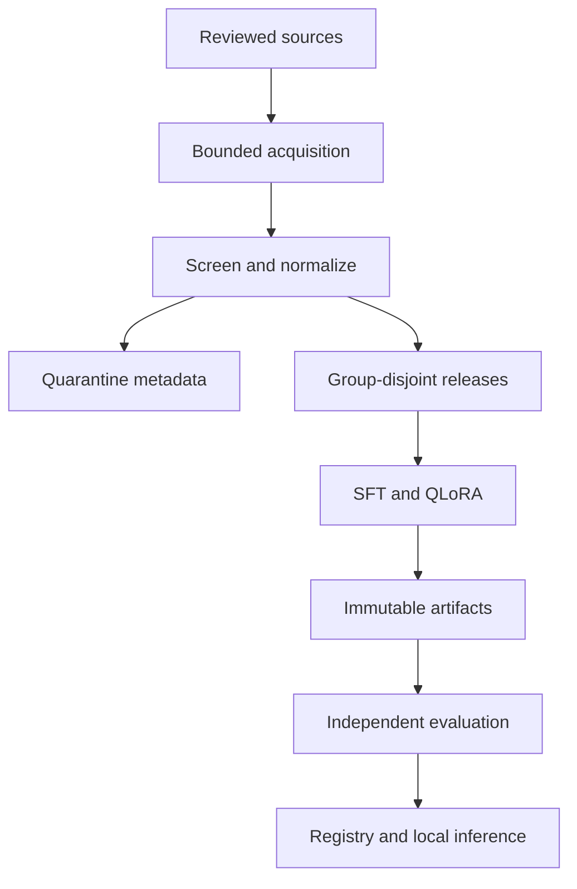

# Rsec AI · v0.2.1-alpha

Independent local model research for **defensive cybersecurity, programming and software engineering**, owned by Snowwiy.
[Independent audit](INDEPENDENT_AUDIT.md) · [Español](README.es.md) · [Architecture](docs/ARCHITECTURE.md) · [Test evidence](TEST_RESULTS.md) · [Handoff](HANDOFF.md)

Rsec specializes open-weight models through adapter training. This repository provides the foundation for acquisition, curation, SFT/QLoRA, independent evaluation, artifact export and local inference. It does **not** distribute a trained cybersecurity model or demonstrate superiority over a base model.

Phase 01-B independent audit: **PASS WITH CONDITIONS** for foundation review, **97 tests / 91.34% statement coverage**. GPU training and source-reviewed gold data remain gates; Unsloth is blocked by confirmed dependency conflicts. See [GPU validation](GPU_VALIDATION_PLAN.md) and [dataset readiness](DATASET_READINESS.md).

## Phase 02-B · current status

Programming is a core capability. Rsec now has a complementary software taxonomy, a scoped source catalog, a reproducible train-only replay planner and trainer-compatible mixed release validation. The two tracks retain independent development suites, Rsec-CyberBench and Rsec-CodeBench. Compare both against the pinned base before selecting adapters or quantized artifacts. Advanced software specialization follows expert data review and the hardware gate. See [software engineering](docs/SOFTWARE_ENGINEERING.md) and [benchmark contracts](BENCHMARK_VALIDATION_REPORT.md).

The Phase 02-B branch includes a localhost review UI with Ed25519 decisions, preaudit observations for all 96 original candidates, isolated evidence imports and scripts for CUDA checks. **Dataset readiness FAIL, GPU validation pending, training not ready.** No approved SFT row or private expert gold exists. See [review setup](DATASET_REVIEW_GUIDE.md), [GPU setup](LOCAL_GPU_SETUP.md) and [integration](GITHUB_INTEGRATION_REPORT.md).

## Phase 02-A dataset engineering · historical evidence

**DATASET READINESS: FAIL** for an expert-approved SFT corpus. **TRAINING READINESS: NOT READY.** Phase 02-A was merged into the foundation branch in [PR #2](https://github.com/Snowwiy/Rsec/pull/2); no specialized model was trained. Actual validation: **200 tests / 94.02% statement coverage**, core without Torch **189 passed**.

The registry inventories **20 external sources plus 2 internal fixture sources** with separate access/download/training/redistribution permissions. Only three pinned CVE documents were acquired for reference-only normalization; no external source is SFT-approved. There are **64 synthetic SFT drafts**, **32 public development/regression cases**, **0 expert-approved examples**, **0 expert gold** and **0 rejected/quarantined actual records**. All 96 conversations await human review, plus three reference interpretations. The quality-conditional 500–1,000 pilot goal is unmet.

```bash
rsec data sources
rsec data download --registered
rsec data curate --input data/pilot/candidates.jsonl --output data/processed/pilot-review --version pilot-0.2.0
rsec data validate data/processed/pilot-review
rsec data quality data/processed/pilot-review
rsec data review data/processed/pilot-review --output reports/pilot-review.json
rsec benchmark validate
rsec benchmark contamination-check --input data/pilot/candidates.jsonl
```

Review packet creation approves nothing. `data split` correctly blocks this unreviewed pilot; no train/eval/test release exists. Optional `rsec data stats data/processed/pilot-review --tokenizer /local/reviewed-tokenizer` measures actual template lengths; without a tokenizer, whitespace counts are explicitly separate. Measured existing Qwen tokenizer total: 16,114 pilot conversation tokens, max 414, eligible SFT tokens/epoch 0. No VRAM/time estimate follows.

[Dataset architecture](docs/DATASET_ARCHITECTURE.md) · [Sources](docs/DATASET_SOURCES.md) · [License matrix](docs/LICENSE_MATRIX.md) · [Taxonomy](docs/DATASET_TAXONOMY.md) · [Human review](docs/DATASET_REVIEW_GUIDE.md) · [Engineering report](DATASET_ENGINEERING_REPORT.md) · [Dataset card](DATASET_CARD.md) · [CyberBench](BENCHMARK_REPORT.md) · [Training gates](TRAINING_READINESS.md).

## Current scope

| Component | Status | Evidence / boundary |
|---|---|---|
| CLI, configuration, curated data pipeline, hashing and split isolation | TESTED | CPU tests and synthetic fixtures |
| Real tiny CPU SFT, LoRA, optimizer resume, merge and offline inference | TESTED | Integration test, no model download |
| QLoRA on RTX 4070 / T4 / other NVIDIA GPUs | GPU VALIDATION PENDING | Implemented backend; no CUDA device in development environment |
| DDP / FSDP and heterogeneous 4070 + 3060 | GPU VALIDATION PENDING | Experimental profiles and launch guards |
| Unsloth backend | BLOCKED | Version 2026.11.12 conflicts with the audited Transformers/TRL/datasets pins |
| Independent benchmark runner and deterministic scoring | TESTED | Reference fixtures test scoring, not model quality |
| GGUF conversion, Q4_K_M and native llama.cpp completion | TESTED | Random tiny Qwen2 CPU artifact only; no 7B quality/compatibility claim |
| Ollama / llama-cpp-python inference | IMPLEMENTED | External runtimes require separate validation |
| RAG / SENTRA | NOT IMPLEMENTED | Contracts and architecture only, intentionally future scope |

## Architecture



Code lives in `src/rsec/`, using the standard Python package layout. Configuration, source policy and benchmark fixtures remain separate. Large data, models, checkpoints, exports and experiments are ignored by Git.

## Install CPU tools

Python 3.11–3.13 is declared; Linux/Python 3.12 is the validated ML target. A core installation needs no PyTorch or CUDA downloads.

```bash
python3 -m venv .venv
source .venv/bin/activate
python -m pip install -r requirements-dev.txt -e .
rsec --help
rsec doctor --output reports/doctor.json
rsec config --profile local_rtx4070
pytest -m 'not ml'
```

`rsec` writes JSON to stdout and actionable input errors to stderr. Exit status is 0 for success, 2 for rejected input or missing dependencies; external runtime failures may retain their native nonzero status. Run from the repository root so the versioned configuration paths resolve.

## Reproduce the real CPU ML check

```bash
python -m pip install torch==2.8.0+cpu --index-url https://download.pytorch.org/whl/cpu
python -m pip install -r requirements-cpu-test.lock
HF_HUB_OFFLINE=1 pytest -m ml
rsec train --smoke
rsec experiments list
```

Smoke mode creates a randomly initialized tiny Qwen2 architecture and a local toy tokenizer. It performs real optimization, evaluation and checkpoint writes. Its losses are infrastructure evidence and have no cybersecurity quality interpretation. `requirements-cpu-test.lock` records exact transitive versions from the tested Python 3.12 CPU environment. GPU profiles are candidate configurations, not validated CUDA locks.

## Legacy foundation data fixtures

```bash
rsec data download
rsec data prepare --input data/samples/defensive.jsonl --output data/processed/demo
rsec data validate data/processed/demo
```

The legacy `sources: []` remains opt-in/empty; `--registered` enables only the three scoped pinned CVE references. The 22-entry registry does not authorize broad acquisition or external SFT. Downloads require a pinned SHA-256, reviewed rights, approved HTTPS hosts, bounded retries/timeouts and size limits. JSON, JSONL, CSV and optional Parquet are supported. HF acquisition requires `rsec data download-hf --help` and a pinned dataset revision. Markdown/text belong to knowledge ingestion, never automatically to instruction-response training:

```bash
rsec data ingest --input authorized.md --output data/interim/knowledge.jsonl \
  --source owner-documentation --source-url https://example.org/authorized \
  --license LicenseRef-Owner-Authorized --version reviewed-1 \
  --redistribution internal-only --reviewed --purpose knowledge
```

The following paragraph describes the legacy fixture path; Phase 02 corpus promotion requires `data curate` and hash-bound human decisions. Every legacy SFT record carries source URL, license, source version, provenance family, domain, language, synthetic marker and review status. `--replay` combines reviewed historical inputs before the same screening/splitting process; `--category-cap` bounds dominant categories. The bundled independent benchmark is excluded by default. Extend the benchmark list when adding external suites. Splits are stable for fixed inputs and seed; acquisition timestamps naturally differ between new releases.

Rejects retain hashes and reasons only. Secret/PII/poisoning detection and anonymization are conservative heuristics, with false positives and false negatives. Human review remains necessary. See [dataset policy](docs/DATASET_POLICY.md).

## GPU training and recovery — future gated execution

The following GPU commands are procedures for a later authorized phase after TRAINING_READINESS.md gates pass. Use Linux or WSL2 with a verified NVIDIA driver. The owner's RTX 4070 has 12 GB VRAM and the planned RTX 3060 has a separate 12 GB. Neither DDP nor adding a second card creates a contiguous 24 GB allocation.

Install the correct **PyTorch 2.8.0 CUDA wheel separately** using the official PyTorch installer for the driver, then:

```bash
python -m pip install -r requirements-train.txt -e .
rsec doctor
rsec train --profile local_rtx4070 --allow-network
```

`--allow-network` permits the first download of the pinned public base model. With its cache already present, omit this option for offline training. The default base is `Qwen/Qwen2.5-Coder-7B-Instruct`, pinned in configuration; Apache-2.0 applies to that base, while existing Rsec code remains MIT. See [ADR 001](docs/adr/001-base-model.md).

QLoRA uses NF4, double quantization, configurable LoRA modules, rank 16/alpha 32, response-only completion loss, microbatch 1, accumulation 16 and context 2048 by default. Templates come from the selected tokenizer; unsupported assistant masks fail explicitly. Overlength examples are rejected instead of silently truncating responses. Hardware must confirm memory feasibility.

```bash
rsec train --resume experiments/RUN/checkpoints/checkpoint-100
rsec train --adapter experiments/PRIOR/adapter --output experiments/incremental
accelerate launch --config_file configs/accelerate/multi_gpu_ddp.yaml \
  -m rsec.train --profile local_rtx4070_rtx3060 --allow-experimental
accelerate launch --config_file configs/accelerate/multi_gpu_fsdp.yaml \
  -m rsec.train --profile local_fsdp --allow-experimental
```

`--resume` restores model/optimizer/scheduler/RNG state from a locally trusted, hash-verified checkpoint. `--adapter` starts a **new** experiment; it is not optimizer resume. Do not load checkpoints received from untrusted parties: hashes detect corruption, not authenticity. No automatic checkpoint pruning or overwriting is enabled. Ctrl+C requests a stop/save at the next completed optimizer step; an OOM marks the experiment failed and preserves previously saved checkpoints.

Profiles cover Colab T4, Kaggle, RunPod, single GPU, experimental heterogeneous DDP/FSDP, and 24/48 GB GPUs. See [training](docs/TRAINING_GUIDE.md) and [multi-GPU validation protocol](docs/MULTI_GPU.md). No paid service is launched by the code.

## Independent evaluation

```bash
rsec predict --model /local/base --output reports/base-predictions.jsonl
rsec evaluate --benchmark benchmarks/suite.jsonl --predictions reports/base-predictions.jsonl \
  --model-id base --output reports/base.json
rsec predict --model /local/base --adapter /local/rsec-adapter --output reports/adapter-predictions.jsonl
rsec evaluate --benchmark benchmarks/suite.jsonl --predictions reports/adapter-predictions.jsonl \
  --model-id adapter --baseline reports/base.json --output reports/adapter.json
```

Base, adapters, merged, quantized and older versions use the same prediction schema. Regression approval additionally requires matching recorded generation/evaluation conditions, tokenizer template and system hashes; `predict` writes a metadata sidecar. Manually supplied predictions without comparable metadata can be scored but cannot pass the regression gate. Reports include accuracy, macro/micro F1, per-class precision/recall, false positive/negative rates, CWE exact match, schema compliance, domain/language breakdowns and measured runtime metadata when present. Unsupported-reference rate is a narrow deterministic proxy, not a full hallucination metric. Independent human assessment and controlled remediation testing are required before model release. Generated code is never executed on the host.

## Export and local inference

```bash
rsec export --source /local/adapter --output exports/adapter-v1 --format adapter
rsec export --source /local/adapter --base /local/unquantized-base --output exports/merged-v1 --format merged
rsec export --source exports/merged-v1 --output exports/gguf-v1 --format gguf \
  --llama-cpp /local/reviewed-llama.cpp --quantization Q4_K_M
rsec infer --model exports/merged-v1 --prompt 'Explain the evidence needed to triage this alert.'
rsec infer --backend llama-cpp --model exports/gguf-v1/rsec-Q4_K_M.gguf --prompt 'Explica cómo verificar una remediación.'
ollama create rsec -f exports/gguf-v1/Modelfile
ollama run rsec
rsec infer --backend ollama --model rsec --prompt 'Identify the missing evidence.'
```

GGUF needs a clean, reviewed llama.cpp checkout with its Python converter dependencies and built `build/bin/llama-quantize`. Export checks RAM/storage before merging/conversion, verifies Safetensors or GGUF headers, preserves tokenizer/templates, emits hashes/sizes, and refuses existing destinations. Export can run on a separate machine. A full 7B merge may exceed the owner's available RAM; larger models need independent planning. Ollama is contacted through loopback; install models locally beforehand. For multi-GPU GGUF bindings use `--gpu-layers` and `--tensor-split`; this is distinct from training distribution.

## Registry and experiment tracking

```bash
rsec models list
rsec models register /local/reviewed-model-metadata.json
rsec models activate reviewed-version-id
rsec experiments list
```

Registry entries are immutable and reference actual artifacts and hashes. Activation verifies integrity and a recorded TESTED state; activating an older validated entry provides rollback. Human release signoff must include independent evaluation and regression evidence. Experiments write configuration, code commit, dataset hash, environment, JSONL/CSV metrics, Markdown status and an SVG loss plot when observations exist. External telemetry is disabled; optional TensorBoard requires an explicit setting.

## Security, privacy and limitations

Only defensive, authorized work is in scope. No exploitation agent, credential collection, GUI, hosted commercial API dependency, full RAG or SENTRA integration is included. Safetensors and `trust_remote_code=False` are mandatory defaults. Data never leaves the machine except explicit downloads or a user-selected local service. CI runs with read-only permissions, immutable action references and no privileged PR workflow. Third-party acquisition, native converters and local checkpoints still require trust review. See [threat model](docs/SECURITY.md).

Minimum CPU tooling: Python and approximately 1 GB free memory/storage. The tiny ML check needs substantially more for PyTorch. Recommended GPU research setup: Linux/WSL2, verified CUDA driver, 32 GB RAM and SSD capacity planned for base weights, caches, optimizer checkpoints and exports. These are planning recommendations, not measured 7B memory guarantees.

[Colab notebook](notebooks/Rsec_Colab.ipynb) · [Kaggle notebook](notebooks/Rsec_Kaggle.ipynb) · [RunPod/WSL2 guide](docs/TRAINING_GUIDE.md)

## License and contributions

The pre-existing MIT license is retained. Model, adapter and dataset rights must be reviewed separately; Rsec's license does not relicense third-party assets. See [dependencies](docs/DEPENDENCIES.md), [MODEL_CARD.md](MODEL_CARD.md), [ROADMAP.md](ROADMAP.md) and [AGENTS.md](AGENTS.md). Contributions require provenance, meaningful CPU tests, explicit hardware status and coherent English/Spanish documentation. Do not commit private logs, credentials, models or heavy artifacts.
