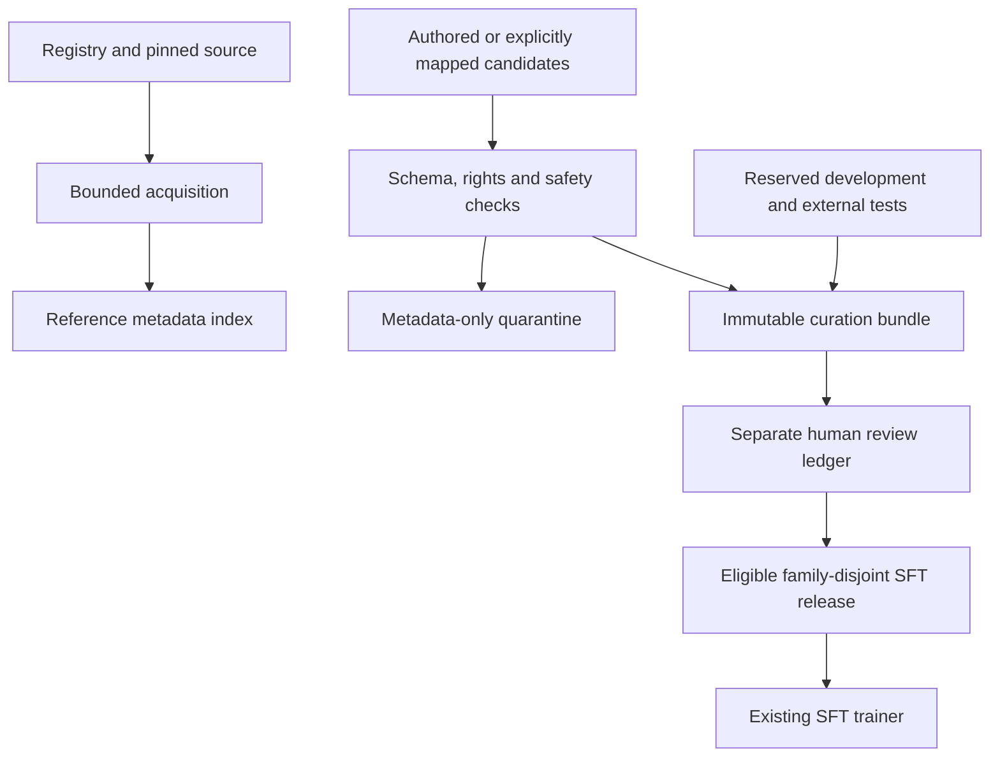

# Dataset architecture · v0.2.0-alpha

Phase 02 implements a reviewable data system. **DATASET READINESS: FAIL** for an expert-approved SFT corpus; **TRAINING READINESS: NOT READY**. No specialized training was started. The pilot contains 64 candidate conversations, not 64 approved training examples.

## Boundaries and modules

| Module in `src/rsec/datasets/` | Responsibility |
|---|---|
| `schema.py` | Strict Candidate v2, conversation roles, provenance, references and generation metadata |
| `registry.py` | Separate source access/acquisition/training/redistribution decisions; pinned bounded acquisition |
| `knowledge.py` | Three known pinned CVE documents → reference metadata index; no QA conversion |
| `pilot.py` | Deterministic controlled EN/ES scenario drafts; separate development benchmark specifications |
| `quality.py` | Mechanical eligibility, rights, privacy, anomaly and reference checks; no technical truth certification |
| `linkage.py` | Origin/family/translation links, lexical similarity and normalized code fingerprints |
| `review.py` | Explicit operator-supplied human attestations bound to content and source-policy hashes |
| `release.py` | Immutable staging, quarantine metadata, inventory verification, group splitting and SFT bridge |
| `stats.py` | Whitespace statistics or measured local-tokenizer lengths with template/file identities |
| `benchmark.py` | Public development reservations, mechanical metrics and human category-rating aggregation |
| `cli.py` | New commands delegated through the existing CLI without importing CUDA for core operations |

Documents, benchmark candidates, regression cases and SFT candidates retain distinct `purpose` values. Knowledge is not converted to instruction-response data. The CVE adapter emits an index with `trusted=false`, not a complete RAG system or technically interpreted advisory corpus. Untrusted text never becomes pipeline instructions and no dataset code is executed.

## Staging and promotion

`data curate` consumes Candidate v2 JSONL. Each accepted row preserves taxonomy version, origin/families, translation linkage, references, synthetic generation method/date/authorization, and review state. Invalid rows produce hashes/reasons, not private source content. Global malformed-file or processing-budget failures abort; a partial directory without a valid manifest is unusable and must not be promoted.

A bundle snapshots records, per-record checks, reviews, registry, taxonomy, reservations, status and a complete SHA-256 inventory. No overwrite is allowed. Validation checks inventory, paths, symlinks, hashes **and semantic eligibility**; recomputing a file checksum alone does not bypass review or separation checks. Manifests detect accidental or partial tampering; they are unsigned and do not authenticate the operator or an attacker replacing the complete trust root.

Only records with valid independent review decisions can cross the bridge to the existing flat Record schema. The full v2 records, decisions and policies accompany the SFT files so `data validate` can reconstruct eligibility. Training text contains `messages` only; source/quality metadata are not appended. The trainer's original template/mask/padding/loss logic remains unchanged. A real TRL CPU test validates the bridge and assistant targets.

Zero eligible records or fewer than three independent approved families leaves a valid staging bundle with **no SFT directory**. Current train/eval/test are therefore absent, not empty training releases. A partially reviewed bundle remains inspectable. Approved families split deterministically with seed 42 and advisory 85/10/5 targets, with at least one family per split. Freeze external tests across future releases; re-splitting replay is not longitudinal test independence.

## Compatibility and scaling limits

Legacy `data prepare`, JSON/JSONL/CSV/optional Parquet and legacy fixtures remain supported for foundation regression. They do not create Phase 02 expert approval: new corpus releases must use `data curate` and the v2 bridge. External datasets require an explicit Candidate mapping; there are no live NVD/OSV/Sigma/HF bulk adapters in this phase. The only concrete external normalization is the bounded CVE reference adapter.

Curation and reservation input budgets are 10,000 rows; the shared loader also bounds bytes. Similarity uses an inverted shingle index and a 200,000-pair budget that aborts safely. Worst-case repetitive data can still hit that budget. Shard large corpora and perform cross-shard grouping/reservation before promotion; local shard success alone does not certify a global release. Language/domain/difficulty are declared and mechanically checked, with limited hints; expert classification remains pending.

Run from repository root. LF output and `.gitattributes` preserve bytes across checkouts; Windows/WSL2 physical execution remains untested. Core processing has no Torch dependency; tokenizer measurement is an optional local ML operation. See [quality](DATASET_QUALITY_STANDARD.md), [review](DATASET_REVIEW_GUIDE.md) and [contamination](BENCHMARK_CONTAMINATION_POLICY.md).
